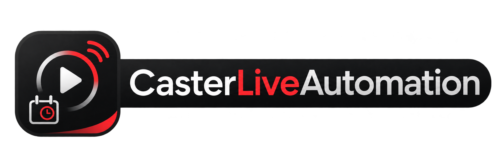

# CasterLiveAutomation



**Open-source Windows scheduling and GUI automation for CasterLive DJ.**

**Version 1.0 - Stable release** · **Created by @Alessio278** · [MIT source license](LICENSE)

[Italiano](docs/README.it.md) | [Español](docs/README.es.md) | [Français](docs/README.fr.md) | [Installation](docs/INSTALLATION.md) | [Testing](docs/TEST.md) | [Known limitations](docs/KNOWN_LIMITATIONS.md)

**Stable release:** CasterLiveAutomation **1.0 is the first definitive, stable version** of the application. Further updates may be released if needed. The Windows build is checked automatically before publication; as with any GUI-based broadcast automation, configure and test START/CLOSE under supervision before unattended use. A green status indicator does not prove that audio is streaming.

## Features

- Multiple **non-overlapping schedules**, each with recurring weekdays, extra one-off start dates, start time and close time. Intervals can cross midnight.
- A shared application (CasterLive DJ), with configurable **OPEN, CLICK, WAIT, CLOSE** sequences.
- Button editor with 13 optional default labels; coordinates only required for buttons actually used by a sequence.
- Defensively recover hidden/minimized Windows; re-evaluate button positions after movement, require matching client dimensions, and refuse unsafe clicks.
- Explicit initial pause, **zero schedules on first run**, activity and diagnostics, automatic tray startup, and manual test controls.
- Compact dark UI with Italian, English, Spanish and French selections. Some advanced dialogs and diagnostic entries are still Italian - see [language coverage](docs/LANGUAGES.md).

**Default START:** `OPEN -> LOGIN -> STOP x3 -> SEND`

**Default CLOSE:** `SEND -> NEXT -> CLOSE` (only after a successful scheduled START).

All schedules currently share the same target program and action sequences. The user must be signed in to Windows with the desktop **unlocked**; this is GUI automation, not a broadcasting API or a service.

## Running from source

1. Install [AutoHotkey v2](https://www.autohotkey.com/) and CasterLive DJ separately.
2. Put `CasterLiveAutomation.ahk`, `CasterLiveAutomation_Worker.ahk` and `CasterLiveAutomation_ScheduleLib.ahk` together in a writable folder.
3. Double-click `CasterLiveAutomation.ahk`. The initial state is **PAUSED** and there are **no schedules**.
4. Select the CasterLive DJ executable, create a schedule, calibrate the required buttons, review the sequences, and explicitly choose **Resume automation**.
5. Complete a supervised START/CLOSE test with no live broadcast running.

See [installation](docs/INSTALLATION.md) and [guida italiana](docs/INSTALLAZIONE_IT.md).

## Windows binaries

The repository includes a **Windows-only build script** at `scripts/Build-Windows.ps1`. When run with an installed AutoHotkey v2 compiler (Ahk2Exe), it is designed to produce **two** autonomous executables in a versioned ZIP: a UI program and a separate scheduler Worker. They must remain in the **same directory**.

This repository ZIP contains source code, not compiled EXEs; the release workflow builds the Windows package on a Windows runner. A successful build is not a test against a live CasterLive DJ session. A single-executable distribution would require a separate architecture review.

See [Windows build](docs/WINDOWS_BUILD.md), [third-party notices](third_party/README.md), and [release policy](docs/RELEASE_PROCESS.md).

## Brand assets

The project's original artwork is stored in [`assets/branding`](assets/branding/):

- `CasterLiveAutomation-logo.png` - horizontal wordmark for GitHub and project pages.
- `CasterLiveAutomation-icon.png` - square application icon.
- `CasterLiveAutomation.ico` - Windows tray/window/compiled EXE icon.

The Windows build embeds the same `.ico` into both binaries. Keep `assets/branding/CasterLiveAutomation.ico` beside the compiled GUI in the documented directory layout so the GUI can display the tray and window icon. This branding is original project artwork, not the official CasterLive DJ logo.

## Repository layout

```text
CasterLiveAutomation.ahk              # GUI, schedule editor, diagnostics
CasterLiveAutomation_Worker.ahk       # independent scheduler and safe clicks
CasterLiveAutomation_ScheduleLib.ahk  # calendar and migration utilities
assets/branding/                      # logo PNG + Windows ICO resources
scripts/Build-Windows.ps1             # Windows build and packaging
tests/                               # source checks and AHK calendar tests
docs/                                # guides, safety, translations, release process
third_party/                         # AutoHotkey license reference
.github/                              # Issues, PRs, CI
```

Private collaboration notes (`AI_PROJECT_INSTRUCTIONS.md`, `PROJECT_STATE.md`, `PROJECT_KNOWLEDGE.md`) are intentionally kept **outside** this repository and are never required by CI. Configuration, saved schedules, runtime state and logs are created locally and ignored by Git. **Never upload them to Issues or commit them to the public repository.** See [privacy](docs/PRIVACY.md).

## Status and development

- **Source review/static tests:** applicable automated checks can run without Windows.
- **Windows calendar tests:** must be run on Windows with AutoHotkey v2.
- **Windows UI and broadcasting test:** requires manual real-window validation.
- **GitHub release:** 1.0 is the **stable** release. GitHub Actions automatically publishes a stable Windows release for a new `VERSION` on the default branch (or a matching pushed tag) after its checks pass. Existing tags/releases are not overwritten. Later versions (`1.1`, `2.0`, etc.) may follow if needed.

See [changelog](CHANGELOG.md), [contributing](CONTRIBUTING.md) and [security](SECURITY.md).

## Attribution and independence

**Created by @Alessio278**. Project-specific source code is licensed under MIT. The AutoHotkey interpreter is subject to its own license, as explained in [third_party/README.md](third_party/README.md).

CasterLive DJ is a separate third-party product. This project is **not affiliated with its developer**, and does not include or redistribute that application.
