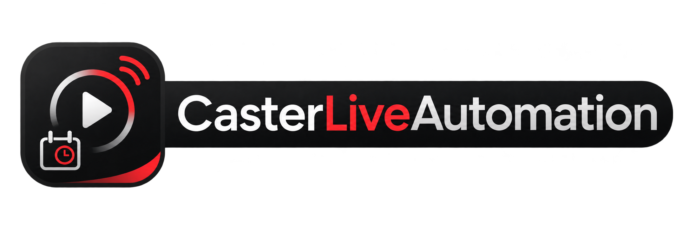

# CasterLiveAutomation - Español

**Versión 1.0 - pendiente de validación en Windows**  
**Created by @Alessio278**

[English](../README.md) | [Italiano](README.it.md) | [Français](README.fr.md)

CasterLiveAutomation automatiza el inicio y el cierre de CasterLive DJ en Windows mediante programaciones independientes, sin solapamientos, y secuencias de acciones configurables. No está afiliado al desarrollador de CasterLive DJ.

## Funciones

- Programaciones con días recurrentes, fechas especiales e intervalos que cruzan la medianoche.
- Acciones **ABRIR, CLIC, ESPERAR y CERRAR**. Secuencia inicial: `ABRIR -> LOGIN -> STOP x3 -> SEND`; cierre: `SEND -> NEXT -> CERRAR`.
- Botones configurables, recuperación de ventanas minimizadas y bloqueo de clics inseguros.
- Interfaz oscura, cuatro idiomas, bandeja del sistema y diagnóstico.
- Primera ejecución **EN PAUSA y sin programaciones**.

## Instalación

Instala AutoHotkey v2 y CasterLive DJ por separado. Mantén los tres archivos `.ahk` juntos y ejecuta `CasterLiveAutomation.ahk`. Selecciona la aplicación, añade una programación, configura los botones utilizados y pulsa **Reanudar**. Realiza una prueba supervisada sin emisión en directo.

Para compilaciones de Windows consulta [WINDOWS_BUILD.md](WINDOWS_BUILD.md); no se ha comprobado una distribución `.exe` en esta sesión. Más información en el [README principal](../README.md).

## Seguridad

Windows debe estar desbloqueado y con la sesión iniciada para simular clics. La aplicación detiene las acciones cuando no puede verificar la ventana. Un indicador verde no garantiza que el sonido esté emitiéndose. **La versión 1.0 no está certificada para uso desatendido.**

Código fuente MIT; el intérprete AutoHotkey tiene su propia licencia. No publiques datos de configuración ni registros personales. **Created by @Alessio278**.
