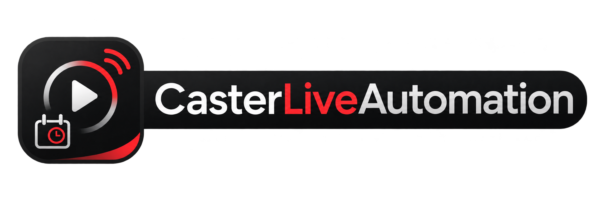

# CasterLiveAutomation - Français

**Version 1.0 - version stable et définitive**  
**Created by @Alessio278**

[English](../README.md) | [Italiano](README.it.md) | [Español](README.es.md)

CasterLiveAutomation automatise le démarrage et la fermeture de CasterLive DJ sous Windows, grâce à des programmations non chevauchantes et à des séquences d'actions personnalisables. Il s'agit d'un projet indépendant.

## Fonctions

- Plusieurs programmations avec jours récurrents, dates supplémentaires et horaires traversant minuit.
- Actions **OUVRIR, CLIC, ATTENDRE et FERMER**. Séquences par défaut : `OUVRIR -> LOGIN -> STOP x3 -> SEND`, puis `SEND -> NEXT -> FERMER`.
- Boutons configurables, récupération des fenêtres minimisées, refus des clics non sécurisés.
- Interface sombre, quatre langues, zone de notification et diagnostic.
- Premier démarrage **EN PAUSE sans programmation**.

## Démarrage

Installez séparément AutoHotkey v2 et CasterLive DJ. Conservez les trois fichiers `.ahk` dans le même dossier et exécutez `CasterLiveAutomation.ahk`. Sélectionnez l'application, créez une programmation, configurez les boutons nécessaires, puis choisissez **Reprendre**. Effectuez un essai complet sous surveillance, sans diffusion en cours.

La compilation Windows est expliquée dans [WINDOWS_BUILD.md](WINDOWS_BUILD.md). Aucun exécutable Windows n'a été validé dans cette session. Voir le [README principal](../README.md).

## Sécurité

La session Windows doit être ouverte et le bureau déverrouillé. Le logiciel refuse les clics lorsque la cible ne peut pas être vérifiée. Un voyant vert ne signifie pas que la diffusion est active. **La version 1.0 est la première version stable et définitive ; d'éventuelles mises à jour pourront suivre.** Les contrôles automatisés ne remplacent pas un test supervisé avec CasterLive DJ.

Code source MIT; l'interpréteur AutoHotkey dispose de sa propre licence. Ne publiez jamais vos configurations ou journaux personnels. **Created by @Alessio278**.
