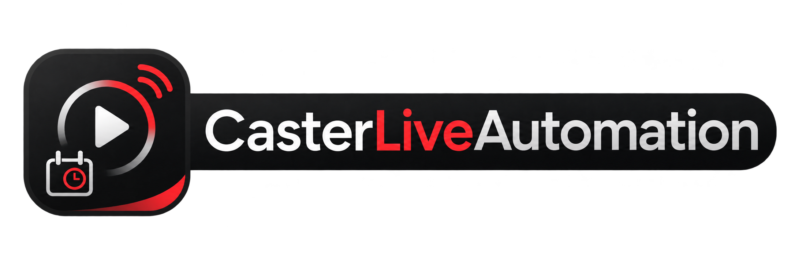

# CasterLiveAutomation - Italiano

**Versione 1.0 - verifica Windows ancora necessaria**  
**Created by @Alessio278**

[English](../README.md) | [Español](README.es.md) | [Français](README.fr.md)

CasterLiveAutomation automatizza l'avvio e la chiusura di CasterLive DJ su Windows attraverso calendari senza sovrapposizioni e sequenze personalizzabili. È un progetto open source indipendente.

## Funzioni

- Più schedulazioni non sovrapposte con giorni ricorrenti, date extra e intervalli anche 23:00-02:00.
- Sequenze **APRI, CLIC, ATTESA e CHIUDI**. Di default: `APRI -> LOGIN -> STOP x3 -> SEND` e `SEND -> NEXT -> CHIUDI`.
- Pulsanti configurabili e clic controllati rispetto alla finestra, con blocco se la posizione non è affidabile.
- Interfaccia scura, quattro lingue, gestione in area di notifica, log e diagnosi.
- Primo avvio **IN PAUSA e senza schedulazioni**.

## Avvio

Installa AutoHotkey v2 e CasterLive DJ separatamente; metti i tre sorgenti `.ahk` nella stessa cartella e apri `CasterLiveAutomation.ahk`. Scegli l'eseguibile di Caster, crea un calendario, registra solo i tasti necessari e premi **Riprendi automazione**. Esegui prima un test completo in presenza di un operatore, con trasmissione disattivata.

La compilazione Windows è descritta in [WINDOWS_BUILD.md](WINDOWS_BUILD.md): **non è stato ancora prodotto un EXE verificato** in questa sessione. La pagina di sviluppo è [README in inglese](../README.md).

## Sicurezza e stato

L'utente Windows deve essere collegato e il desktop sbloccato. Se la finestra non può essere identificata in modo sicuro, il programma blocca i clic. Lo stato verde non prova che l'audio sia online. **La V1.0 deve ancora superare i test su Windows prima di una release stabile.** Vedi [TEST.md](TEST.md).

Licenza del codice sorgente: MIT. Il runtime AutoHotkey possiede una propria licenza. Nessun file locale di impostazioni o log deve essere pubblicato. **Created by @Alessio278**.
